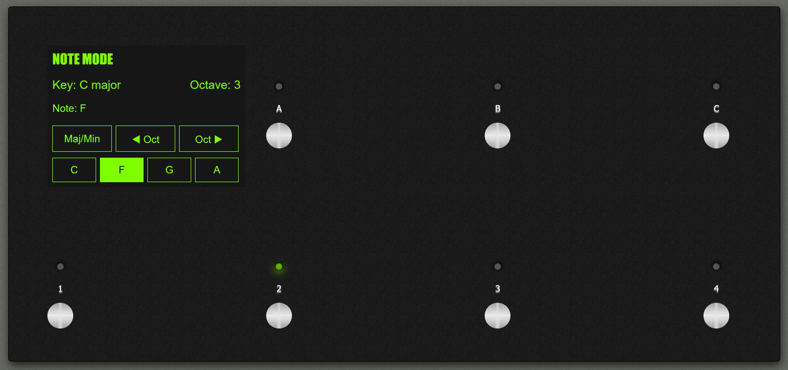
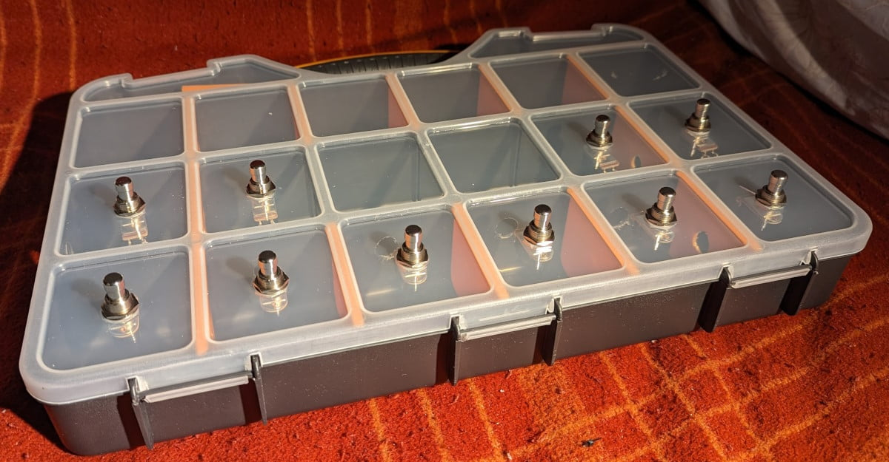

# MIDI Toolbox

A highly configurable MIDI footswitch controller for musicians whose hands are already busy - for example, a guitarist. It sends MIDI to a laptop (or anything that takes USB-MIDI) to play notes and chords, change programs, send control changes and navigate between sets of sounds.

> ⚠️ **Build at your own risk.** MIDI Toolbox is provided "as is", with no warranty of any kind. Building a unit involves drilling, cutting, soldering and mains-powered tools, and the wiring, drawings and schematics here and in the Designer **have not been reviewed by a qualified engineer**.
>
> - **Measure your own parts before you drill or cut anything.** Hole sizes in the drawings are assumptions, and holes cannot be un-drilled.
> - **Verify your wiring** against your parts' datasheets, and check it with a multimeter, before you apply power. A mistake can damage the Teensy, the screen or your computer's USB port.

This project is currently focussed on the Teensy 4.1. We may be able to support other Arduino-like devices in the future.

The project has four parts:

| Part | What it is | Where |
| --- | --- | --- |
| **Firmware** | Arduino/C++ for a Teensy 4.1. Reads the footswitches, drives the RGB LEDs and touchscreen, and sends USB-MIDI. | [`MIDI-Toolbox/`](MIDI-Toolbox/) |
| **Designer** | A web app to design *your own* unit: how many buttons, where they go, which screen. It produces a drilling drawing, a wiring schematic, a parts list and a `device.json` (plus an optional `MidiToolboxDevice.h`) describing the wiring to the firmware. | [`Designer/`](Designer/) |
| **Editor** | A web app to configure what the buttons do (notes, chords, program changes, control changes, navigation...) and save it as a `.json` file for the unit's SD card. | [`Editor/`](Editor/) |
| **Desktop app** | The Editor and Designer in one program for Windows, Linux and macOS, plus a Device tab that talks to the unit over USB: it installs the unit's `device.json` and your configs and updates the firmware, so you do not need the Arduino IDE. | [`App/`](App/) |

**Easiest start: download the desktop app** ([how](docs/desktop-app-guide.md#installing-it)). It includes the Editor and Designer, installs the firmware and your `device.json` and configs over USB, and needs neither the Arduino IDE nor Node.js.

The Editor and Designer also run entirely in your browser - there is no server and nothing is uploaded.

- Home page: <https://yorkshiretwist.github.io/MidiToolbox/>
- Editor: <https://yorkshiretwist.github.io/MidiToolbox/editor/>
- Designer: <https://yorkshiretwist.github.io/MidiToolbox/designer/>

## Documentation

1. [Hardware build: the original 13-button unit](docs/hardware-build.md) - parts, wiring, flashing the firmware, SD card.
2. [Designing your own unit with the Designer](docs/designer-guide.md)
3. [Configuring your buttons with the Editor](docs/editor-guide.md)
4. [How navigation works](docs/navigation.md)
5. [Running the firmware unit tests](MIDI-Toolbox/test/README.md)
6. [The desktop app guide](docs/desktop-app-guide.md): install it, set up a unit, build it
7. [The USB serial protocol](docs/serial-protocol.md) the app uses

## Project history

I had an idea to build a MIDI pedal board for sending MIDI messages to a laptop while I'm playing guitar. It could send note messages (to trigger samples), or program changes (to change effects) or many other combinations.

Videos like [this by Hacker Shack](https://www.youtube.com/watch?v=M25I58I7BtI) and [this by Notes and Volts](https://www.youtube.com/watch?v=H3WevrsmO9o) make it look easy - well, at least not crazy difficult. And the parts are both easy to obtain and cheap.

Specialised parts, like [this sloped aluminium enclosure](https://uk.farnell.com/bopla/atph-1865-300/case-aluminium-68x300x181mm/dp/1843600), could give the unit a real professional finish. And by adding [a TFT touchscreen](https://www.pjrc.com/store/display_ili9341_touch.html) I could build something really powerful - and completely bespoke to me.

Easy, right?

### The HTML prototype

Before I built anything physical I made a pure software prototype, in HTML, CSS and JavaScript, which I know well enough to make quick progress. It lives in [`html-prototype/`](html-prototype/).

- [`13-buttons.html`](html-prototype/13-buttons.html) was the initial idea, with 13 buttons. I printed the design on paper at scale ([`graphics/drawing.pdf`](graphics/drawing.pdf) - A4 paper is 297 mm long and the unit is 300 mm, which is close enough for jazz) and the buttons were far too close together for my big feet.
- [`7-buttons.html`](html-prototype/7-buttons.html) was the next design: much more comfortable to play, and it let me put the screen in landscape mode.
- [`index.html`](html-prototype/index.html) is still 7 buttons, but driven by a [JSON configuration file](html-prototype/config-example.json) that defines the modes and actions of each button. That made the unit a platform that could do pretty much anything - but while a nerd like me can edit JSON by hand, anyone else would need a GUI. I imagined something like the Blackstar Live Logic app. That idea became the **Editor**.

### Prototype one

The first physical prototype lives in a plastic compartment box (the kind for storing screws), which cost £6.99 - a lot cheaper than a proper aluminium enclosure. By luck the compartments were almost exactly the right spacing for the buttons.

It was written in C++ using the Arduino IDE, with libraries and help from [pjrc.com](https://www.pjrc.com). Its first sketches were:

- **MTP** - makes the Teensy appear as a mass-storage device so the JSON config could be copied onto it.
- **ChordPlayer** - five buttons that send chords, a key selector that moves round the cycle of fifths, four "registers" per key (low, middle, high, wide) and MIDI channel changing, to play synth pads under my guitar.

### From prototype to MIDI Toolbox

ChordPlayer was a great way to learn how all this works, but it hard-coded what the buttons did. MIDI Toolbox is what it grew into:

- a **configurable firmware** whose behaviour comes entirely from JSON files on the SD card, organised as *Config → Mode → Bank → Patch → Button → Action*;
- the **Editor**, so nobody has to hand-write that JSON;
- the **Designer**, because not everyone wants my 13-button layout - it generates the device description the firmware reads, so a differently shaped unit is a matter of installing one `device.json` file.

See these pages for more detail:

1. [Hardware build: the original 13-button unit](docs/hardware-build.md) - parts, wiring, flashing the firmware, SD card.
2. [Designing your own unit with the Designer](docs/designer-guide.md)
3. [Configuring your buttons with the Editor](docs/editor-guide.md)
4. [How navigation works](docs/navigation.md)
5. [Running the firmware unit tests](MIDI-Toolbox/test/README.md)
6. [The desktop app guide](docs/desktop-app-guide.md): install it, set up a unit, build it
7. [The USB serial protocol](docs/serial-protocol.md) the app uses

## Contributing

Pull requests and support requests are welcome, and I will do my best with them. But MIDI Toolbox is a hobby, not my job, so **I cannot give any guarantee that I will respond, or when**. Please be patient, and don't rely on me for anything urgent.

Issues and pull requests are welcome. Please read [CONTRIBUTING.md](CONTRIBUTING.md) first (how to build and test each part, and how contributions are licensed) and the [Code of Conduct](CODE_OF_CONDUCT.md). To report a security problem, see [SECURITY.md](SECURITY.md).

## Licence

MIDI Toolbox is free software, licensed under the [GNU General Public License v3.0 or later](LICENSE): you may use, study, change and share it, and if you distribute it (or a modified version) you must do so under the same licence, with the source. It comes with **no warranty**.

It includes and uses third-party software under its own licences: see [THIRD-PARTY-NOTICES.md](THIRD-PARTY-NOTICES.md).

### Not affiliated

MIDI Toolbox is an independent hobby project. It is not affiliated with, endorsed by or sponsored by PJRC, Teensy, Arduino, Hammond, Farnell, Blackstar or any other company, product or channel mentioned in this repository, whose names belong to their owners and are used only to say what the project works with or was built from.
