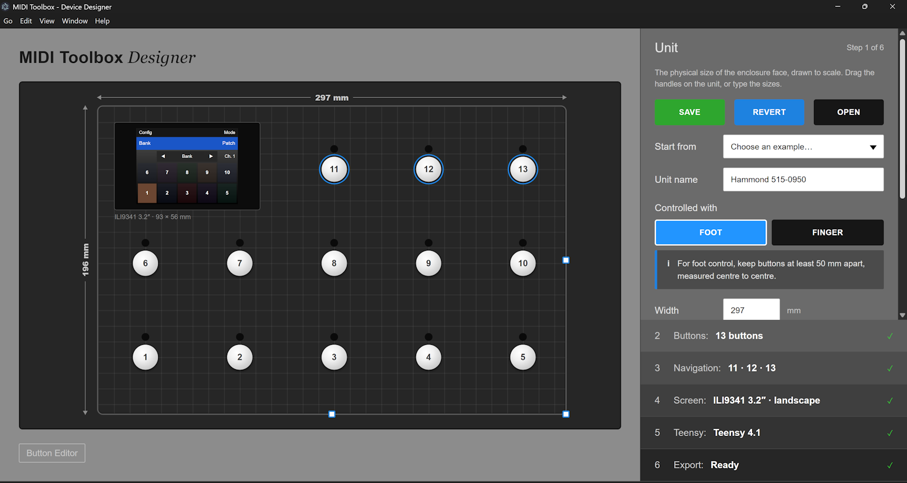
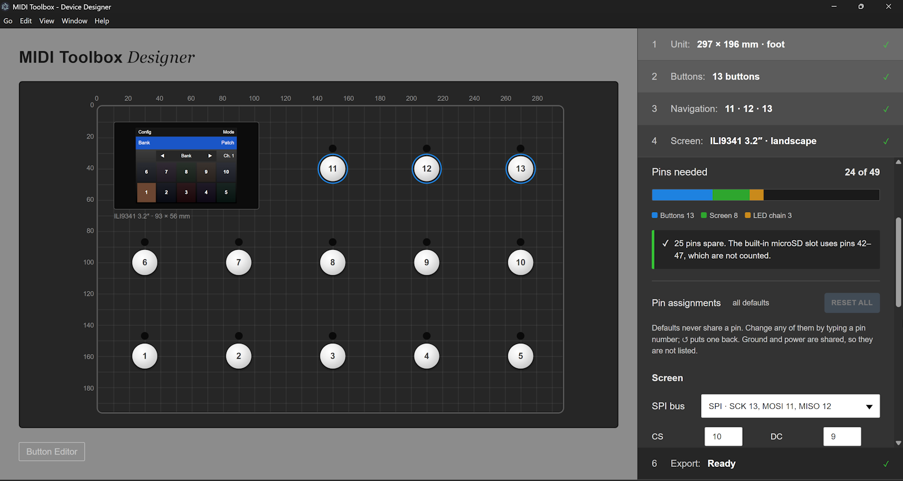
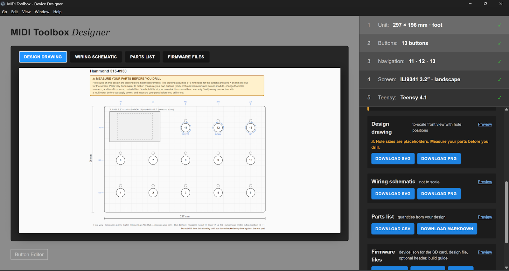

# Designing your own unit with the Designer

The Designer is a web app for planning a custom MIDI Toolbox unit before you pick up a drill. You lay out the buttons and screen on a to-scale front panel, assign Teensy pins, and it generates everything you need to build it:

| Output | What it's for |
| --- | --- |
| `drawing.svg` / PNG | To-scale drilling template with hole positions |
| `schematic.svg` | Wiring diagram (not to scale) |
| `parts.csv` / `parts.md` | Shopping list with quantities derived from your design |
| `MidiToolboxDevice.h` | The compile-time equivalent of `device.json`, for people who build the firmware themselves in the Arduino IDE (optional) |
| `<name>-design.json` | Your design, saved - open it again in the Designer, or load it in the Editor so it knows your layout |
| `device.json` | The unit's wiring as data. The firmware reads it from the SD card at start-up, so you do not need to recompile anything - [the desktop app](desktop-app-guide.md) installs it over USB (see [Using your design](#using-your-design)) |
| `BUILD.md` | Step-by-step build and flashing notes for your design |

Use it in any of three ways: in [the desktop app](desktop-app-guide.md) (the **Designer** screen; no install beyond the download), at <https://yorkshiretwist.github.io/MidiToolbox/designer/>, or [run it locally](#running-locally). It all works offline in your browser or the app; nothing is uploaded.



> ⚠️ **Build at your own risk.** The Designer's outputs are generated, simplified and **have not been tested on real hardware**; they come with no warranty (see the [licence](../LICENSE)).
>
> - **Measure your parts before you drill.** Hole and cut-out sizes in the outputs are catalogue assumptions, not measurements of the parts you bought. Measure your own buttons and screen, correct the drawing, and test-fit on scrap first. Drilling cannot be undone.
> - **Verify your wiring before you power up.** Check every connection on the schematic against your parts' datasheets, and with a multimeter, before you plug anything in.
>
> The same warnings are printed on the drawing, the schematic, the parts list and the build guide the Designer exports.

## How the Designer works

The unit is drawn in the middle of the page; the controls are a stack of six numbered steps. Work through them in order, though you can go back at any time. A checklist at each step shows green ticks, amber warnings (which never block you) and red crosses (which block export until fixed).

**Start from an example** (step 1) rather than a blank page if one is close to what you want: *Current MIDI Toolbox (13 buttons, foot)*, *Large foot unit (35 buttons)*, *Finger pad (11 buttons)* or *Blank unit (6 buttons)*.

**Open** in the header reloads a `<name>-design.json` you saved earlier.

### 1. Unit

The physical size of the face of your enclosure.

- **Unit name** - appears in the firmware header, the Editor and the build guide.
- **Controlled with: Foot or Finger.** This sets the minimum spacing the Designer asks for between button centres (50 mm for feet, 20 mm for fingers) and the assumed hole size. Closer buttons give a warning, not an error.
- **Width / Height** in mm - type them, or drag the handles on the unit.
- **Grid pitch** and **Snap to grid** control how precisely things line up as you drag.

Making the unit smaller never moves anything; whatever ends up outside is flagged in the checks.

### 2. Buttons

Every footswitch (or finger button) on the unit.

- **Click a button** on the unit to select and edit it; drag to move it; press **Delete** (or the X) to remove it.
- **Double-click an empty spot** (or use **Add button +**) to add one.
- **Quick layout** builds a regular grid: choose columns, rows and the centre-to-centre spacing, then **Generate**. It replaces the performance buttons and grows the unit if needed.
- **LED above/below** puts each button's indicator LED on that side. Use *below* for a row that sits beneath another so the LED doesn't collide.
- **Numbering** decides the button **ids** - *bottom-left to top-right*, *top-left to bottom-right*, or *manual*. Ids matter: a performance config refers to buttons by id, so renumbering later changes which physical button each action belongs to.

You need at least 3 performance buttons in addition to the 3 navigation buttons (below).

### 3. Navigation

Exactly three buttons run the built-in navigation role. By default they are the last three ids:

| Role | What it does |
| --- | --- |
| **Select / Set** | Tap to choose which level to navigate (Config, Mode, Bank, Patch, MIDI channel, Page); once something is pending, tap to confirm (**Set?**), hold to revert |
| **Step down** | Previous value of the chosen level |
| **Step up** | Next value |

To change which button has a role, click the role, then click the button on the unit. The on-screen `◀ Parameter ▶` row always mirrors these three, so navigation stays reachable even if a config repurposes the footswitches. See [navigation design](navigation.md) for the full behaviour.

### 4. Screen

Choose your screen model (ILI9341 2.4", 2.8" or 3.2"; ST7789 and ST7796 sizes are listed under **Show untested screens**), its **orientation** (portrait or landscape), and drag it into position on the unit (or type the position of its top-left corner). **Zoom** shows the on-screen button grid at a readable size.

The screen shows a grid that mirrors your performance buttons' physical arrangement, so place the screen sensibly relative to them.

> Only the ILI9341 driver is implemented and verified in the firmware. Other screens are marked **untested**: you'd need to write a small driver adapter for them (see the generated `BUILD.md`). Only the Teensy 4.1 is supported as the microcontroller.

### 5. Teensy

The Designer assigns Teensy pins automatically to the buttons, the screen (SPI, plus touch) and the LED shift-register chain (latch, data, clock), and shows how many pins you've used against what the Teensy has. You can:

- override any individual pin;
- choose the SPI/I²C bus the screen uses;
- see clashes (the same pin used twice - buttons sharing a pin are shown in red).

The LEDs are driven by a daisy-chain of 74HC595 shift registers, so each LED costs no extra Teensy pins - only the three chain pins, which are fixed at 28 (latch), 29 (data) and 30 (clock); the Designer reports an error if you move them.



### 6. Export

Preview each output, then download them individually or all together as a zip. Downloads are blocked while any red-cross item remains.

## Using your design

1. **Build the hardware** using `drawing.svg`, `schematic.svg` and `parts.csv`. First **measure your actual parts** and correct the drawing, and **verify the wiring** against your datasheets and with a multimeter before you apply power. [The 13-button build guide](hardware-build.md) shows what a finished build involves.
2. **Put the universal firmware on the Teensy**, then **install your `device.json`** - the easy way is [the desktop app](desktop-app-guide.md):
   1. In the Designer's **Export** step, download `device.json` (a red-cross item blocks the download until fixed).
   2. Plug the unit into your computer with a USB data cable, open the app's **Device** screen (Go menu, or Ctrl/Cmd + 3) and **Connect**.
   3. If the unit has no firmware yet (or an old one), use the Firmware panel's **Install bundled firmware**. No Arduino IDE needed.
   4. **Upload device.json...**, then **Restart the unit**.

   A unit with no valid `device.json` is in *safe mode*: it deliberately drives no buttons, screen or LEDs until it has one, because a wrong pin number could damage the wiring. The Device screen shows a banner when this is the case. See [Safe mode](desktop-app-guide.md#safe-mode) for why.
3. **Load the `<name>-design.json` in the Editor** so it shows your layout and knows which button ids exist. See the [Editor guide](editor-guide.md). In the desktop app, switch to the **Editor** screen (Ctrl/Cmd + 1) first.
4. **Save your config in the Editor and upload it** from the Device screen (**Upload configs...**), or copy it to the SD card's `/configs` folder yourself.



> **Screens.** The firmware can currently only drive the screen it was built for (the ILI9341 in landscape); a `device.json` that describes a different screen is refused. Choosing the screen at run time is not done yet (see [limitations](desktop-app-guide.md#current-limitations)).

### Without the desktop app

If you would rather build the firmware yourself, copy the generated `MidiToolboxDevice.h` into the `MIDI-Toolbox/` sketch folder (overwriting the existing one) and flash from the Arduino IDE (Board: Teensy 4.1, USB Type: *Serial + MIDI*), as described in [the hardware build](hardware-build.md#firmware). With `DEVICE_JSON_REQUIRED` left at its default the firmware still needs a valid `device.json` on the SD card; see [Safe mode](desktop-app-guide.md#safe-mode) for the option that falls back to the header.

## Running locally

```bash
cd Designer
npm install
npm run dev        # http://localhost:5173 (or similar - see the terminal)
npm run test:run   # unit tests
npm run build      # production build to dist/
```

Requires Node.js 24 (the version used by the CI build). The [desktop app](desktop-app-guide.md) bundles this same web app, so you only need this if you are working on the Designer itself.
