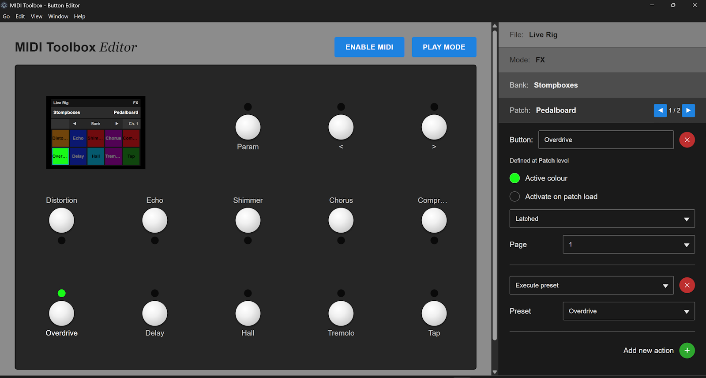
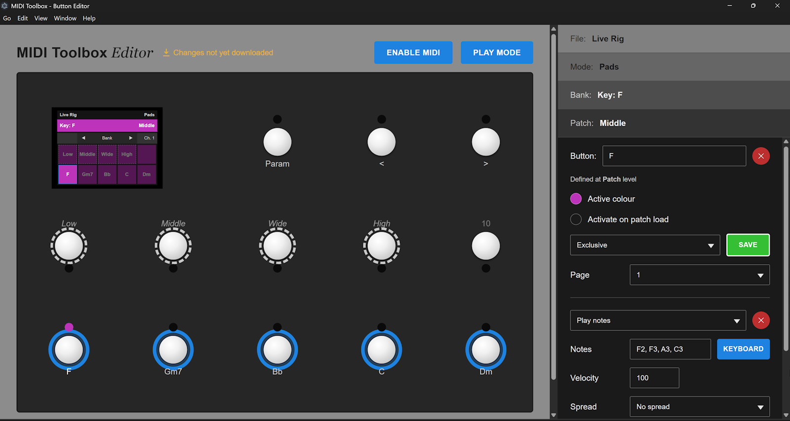
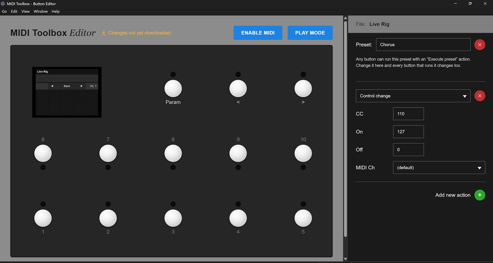
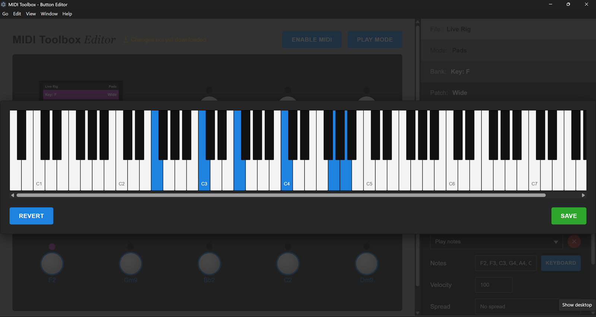
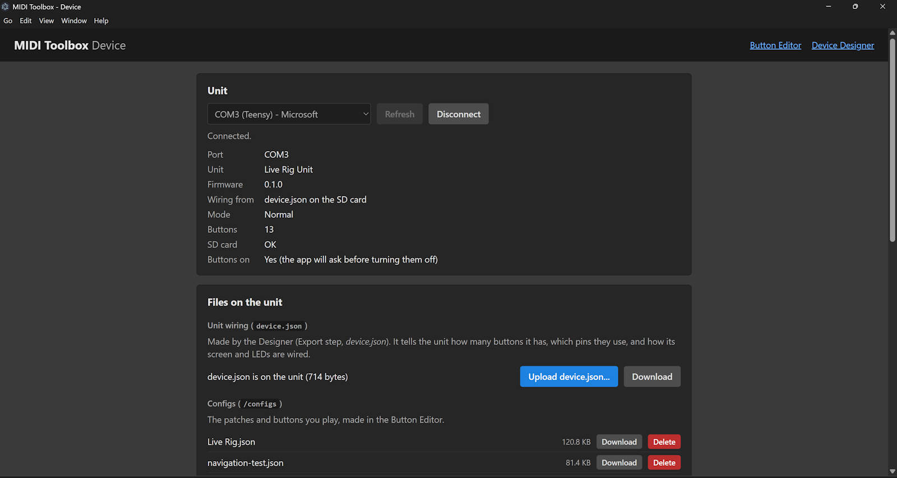

# Configuring your buttons with the Editor

The firmware does nothing until it's given a **config file**. The Editor is a web app for writing those files: you click through your setup, choose what each footswitch does, and save a `.json` file for the unit's SD card. You never need to touch the JSON yourself.

Use it in [the desktop app](desktop-app-guide.md) (the **Editor** screen, which can also send the file to the unit over USB - see [Getting your config onto the unit](#getting-your-config-onto-the-unit)), at <https://yorkshiretwist.github.io/MidiToolbox/editor/>, or [run it locally](#running-locally). Everything stays on your computer; nothing is uploaded.

## The screen

- **Workspace (left)** shows your unit as it will look: the touchscreen at the top and the footswitch board below, with each button lit in its colour. They always show whichever part of the config you are currently editing.
- **Sidebar (right)** is where you edit. It's a drill-down: **File > Mode > Bank > Patch > Button**. Pick an item to open it; the levels above it collapse into breadcrumbs you can click to go back up.
- **Play Mode** (top right) turns the workspace into a simulator - see [Trying it out](#trying-it-out-play-mode).



## Which unit are you configuring?

Button ids and navigation roles depend on your hardware. The Editor starts with the original 13-button unit. If you built your own with the [Designer](designer-guide.md), click **Change device** and open the `<name>-design.json` the Designer saved.

> **Switching device clears every button in the open config.** A config only makes sense for one specific device, because buttons are identified by id. The Editor warns you before it does this.

## The config hierarchy

```
File (config)
  └─ Mode          e.g. "Pads", "Live FX"
       └─ Bank     e.g. "Key: F"
            └─ Patch    e.g. "Verse"
                 └─ Button (one per footswitch id)
                      └─ Action(s)

File also holds Presets: named lists of actions that any button can run
```

Think of it as folders: the navigation switches move you between Modes, Banks and Patches, and the buttons change meaning as you go. A **Patch** is a complete set of button assignments; **Banks** group patches; **Modes** group banks; and the **File** is the whole config.

Each level has a **name** and colours shown in the screen header. A **MIDI channel** set on a level applies to everything beneath it unless a lower level (or an individual action) sets its own.

### Buttons can live at any level

You can define a button at the File, Mode, Bank or Patch level. When you press a footswitch, the most specific level that defines that id wins: **Patch > Bank > Mode > File**. That lets you define buttons that are the same everywhere (say, a "panic" button at File level) and override them only where needed. Overriding is a complete replacement of the button, not a field-by-field merge.

Buttons inherited from a higher level appear on the board and screen with a dashed/italic look. Click one to **override** it: you're asked to confirm, because overriding copies the full definition down and later edits at the higher level will stop affecting your copy.

## Walkthrough

### 1. Start a config

At the File level choose **New** to start from scratch, or **Open** to load an existing `.json` (e.g. [`MIDI-Toolbox/configs/Live Rig.json`](../MIDI-Toolbox/configs/Live%20Rig.json) or the examples in [`config/`](../config/)). Use **Add new mode** to add a Mode.

### 2. Build the hierarchy

Drill into a Mode and add Banks, then into a Bank and add Patches. Rename as you go. The delete (X) button removes an item. Set a patch's **MIDI Ch** to choose the channel it sends on (handy for switching sounds on a synth that listens on different channels).

### 3. Define a button

Select a Patch (or any level), then click a footswitch on the board - or its cell on the screen - to open the Button pane:

| Field | Meaning |
| --- | --- |
| **Name** | Shown on the screen under the button |
| **Active colour** | The colour the button's LED and screen cell light when the button is on |
| **Activate on patch load** | The button starts "on" whenever its patch is loaded |
| **Button mode** | **Momentary** - on while held. **Latched** - each press toggles on/off. **Exclusive** - like Latched, but turning it on turns off the others in its *button set* (like radio buttons - good for choosing one of a set of options) |
| **Button set** | For Exclusive buttons: which buttons are in the group |
| **Page** | If a Patch has more than one page, which page this button belongs to (the navigation switches can flip pages) |

A button with no actions does nothing, so it is **not saved**: if you click an empty footswitch and then move away without adding an action, the draft button is discarded.

### 4. Add actions

A button can have **several actions**, all fired by one press. Use **Add new action** and pick a type.

**Actions run in the order they are listed, top to bottom.** That is true on the unit and in Play mode alike. A button might send a program change, then run a preset, then send a note, and it will do exactly that, in that order.

**Presets**

- **Execute preset** (always the first choice in the list) - run a [preset](#presets-reusable-sets-of-actions). Pick the preset by name from the list that appears below it. The preset's actions run at this point in the button's list, so you can put custom actions before it, after it, or both.

**MIDI messages**

- **Play notes** - one or more notes, e.g. `C2, E2, G2` (or use the keyboard picker). Set **Velocity** (0-127, starting at 100, and never left empty: clear the box and click away and it goes back to what it was. A velocity of 0 makes no sound, because MIDI treats a note-on at velocity 0 as a note-off. A file that has no velocity is shown with 100, and 100 is written into it when you save), a **Spread** (*No spread*, *Spread up*, *Spread down*, *Spread random* - staggers the notes of a chord) and an optional **MIDI Ch** to override the channel just for this action.
- **Program change** - send a **Program** number (0-127), to change a preset on an effects unit or synth. Like the **CC**, **On** and **Off** boxes of a control change and the **Velocity** of a note, it only holds a whole number from 0 to 127: type a bigger number and it becomes 127, a negative one and it becomes 0, and a fraction is rounded. A file that already holds a value outside 0-127 is reported as invalid, and the box fixes it when you click away.
- **Control change** - send controller number **CC** with an **On** value (sent when the button turns on) and an **Off** value (sent when it turns off). They start at 127 (full on) and 0 (full off), and are never left empty: clear a box and click away and it goes back to what it was. A file that doesn't have them is shown with these defaults, and they are written into the file when you save.

**Navigation**

- **Set / Cycle Patch, Bank, Mode, Config** - jump straight to a numbered one (`Set`), or step to the next/previous (`Cycle`, with a direction).
- **Set / Cycle Page** - move between pages of the current Patch.
- **Set / Cycle Parameter** and **Set / Cycle Parameter Value** - choose which thing the arrows adjust (Config, Mode, Bank, Patch, MIDI channel, Page) and change its value.

These are the same actions the three built-in navigation switches use, and you can bind them to any other button too.

> **Navigation never interrupts sound.** Cycling through options only moves a *pending* selection (the text flashes); notes already playing keep sounding. The change takes effect, and old sounds stop, when you activate it with **Set?**. A `Set...` action takes effect immediately. See [navigation design](navigation.md).



### Presets: reusable sets of actions

If several buttons need to do the same thing (say, "switch the amp to the clean sound": a program change plus a couple of control changes), define it once as a **preset** and run it from each of them.

- **Create a preset.** Go to the **File** pane, find **Presets** and choose **Add new preset**. Give it a name, then add one or more actions to it exactly as you would for a button: any action type, in any combination. You can create as many presets as you like. The Presets list is shown alphabetically.
- **Make a preset from a button you have already set up.** At the bottom of the button's pane, next to **Add new action**, choose **Create preset?** and type a name. All of the button's actions move into a new preset with that name, and the button is left with a single **Execute preset** action that runs it. The preset then holds what the button used to do, so you can reuse it on other buttons. The choice is greyed out while the button has no actions, and it isn't shown at all for a button that already runs a preset (a preset can't run another preset, so reorganise that button by hand).
- **Run a preset from a button.** On the button, add an action and choose **Execute preset**, then pick the preset by name (the list is alphabetical). Add as many **Execute preset** actions as you want, mixed in with the button's own actions in any order, and you can run the same preset twice. A button that does nothing but run presets is fine.
- **Edit a preset** and every button that runs it changes with it. The file stores only a reference to the preset (its numeric id) in each button, never a copy, so renaming a preset changes nothing about what the buttons do.
- **Delete a preset** and it is removed from every button that runs it. The confirmation lists those buttons first. A button that had nothing else to do is removed as well, because a button must always do something.

A few rules keep presets simple and predictable:

- **Preset names must be different** (capital letters and spaces at the ends don't count, so "Clean" and " clean" are the same name). The Editor won't let you create or rename a preset to a name another preset already has, and **Add new preset** picks "New preset", "New preset 2" and so on.
- A preset **can't run another preset**: "Execute preset" is not offered inside a preset.
- Set patch / bank / mode actions inside a preset always name their target in full (Mode > Bank > Patch), because a preset isn't in any one place. Use the same preset from anywhere and it goes to the same patch.
- A preset must have at least one action. If a deletion leaves a preset with none (say, the only patch it jumped to was deleted), the preset is removed too.
- Each button that runs a preset gets its own copy of the preset's actions when the config loads, and they follow that button's mode: a *Control change* in a preset sends its On value when a Latched button turns on and its Off value when it turns off, just as it would written directly on the button.

> If a preset is missing from the file, the unit skips just that action and logs a warning; the rest of the button still works.



### 5. The three navigation buttons

On the 13-button unit, ids 10-12 (printed 11-13) are the navigation switches by default: **Select / Set**, **Step down**, **Step up**. The matching on-screen buttons always keep working, so you can't lock yourself out. If you give one of these ids a button definition, the Editor shows a strong warning first, because the physical switch will stop doing its built-in job.

### 6. Download

Click **Download** (File level) to save the config as a `.json` file. The Editor validates the config as you work and marks anything wrong on the item that has the problem; a config with problems can't be used by the unit, so fix those first.

### 7. Put it on the unit

Copy the `.json` file into the `/configs` folder on the unit's SD card (see [Getting configs onto the SD card](hardware-build.md#getting-configs-onto-the-sd-card)). You can keep several config files on the card and switch between them with the Config navigation.

### Reordering and deleting modes, banks and patches

Drag a mode, bank or patch by its grip (⠿) to a new position in its list: drop it on the row it should take the place of and the rows in between shift along, so dragging patch 1 onto patch 3 of five gives 2, 3, 1, 4, 5. (Dragging buttons is different: it swaps the two buttons' footswitches.) Any **Set patch / bank / mode** action that points at something you moved is updated automatically, so it keeps pointing at the same patch, bank or mode. A bank's default patch follows the same way.

Deleting works the same, with one extra step. If any button's Set patch / bank / mode action points at the thing you are deleting, or at anything inside it, the confirmation lists those buttons and where they live, and tells you those actions will be removed. A button left with no actions is removed as well, because a button must always do something. Actions that point at other things are renumbered as needed. The same goes for the Set patch / bank / mode actions inside a [preset](#presets-reusable-sets-of-actions): they are removed, and a preset left with no actions is removed along with the "Execute preset" actions that ran it.



## Trying it out: Play mode

> ⚠️ **The play mode functionality is not yet completed.** There are known issues with play mode in the web and desktop app. This will probably not work for you (yet).

**Play Mode** runs the same navigation model as the firmware. Click the on-screen footswitches to press them, and choose a **MIDI output** from the picker at the top to send real MIDI to a synth, DAW or virtual MIDI port (this uses the browser's Web MIDI support - Chrome and Edge work, and you'll be asked for permission). It's the quickest way to check a config before copying it to the unit. Config-file switching has no meaning here (only one config is loaded), so Set/Cycle Config actions do nothing in Play mode.

Play mode also shows the **button-name overlay**: pressing a button that sends MIDI shows its name over the screen for half a second (a Momentary button's name stays while it is held; a Latched button reads "Name ON" or "Name OFF").

### Large-type "Live" screen

Select a Bank and set its **Screen layout** to **Live** to give the unit a big, readable performance screen while that bank is selected: the Bank and Patch in a large font (plus the Page, when the patch has more than one), with the navigation buttons and MIDI channel along the bottom and no button grid. The default, **Grid**, is the screen you already know. Play mode shows the difference straight away.

## Getting your config onto the unit

- **Desktop app:** save the config, switch to the **Device** screen (Ctrl/Cmd + 3), **Connect** and choose **Upload configs...**. You can send several at once; the unit remembers which one was last selected.
- **SD card:** copy the `.json` into the `/configs` folder on the unit's SD card.

See [the hardware build](hardware-build.md#getting-configs-onto-the-sd-card) for more options.



## Running locally

```bash
cd Editor
npm install
npm run dev        # dev server
npm run test:run   # unit tests
npm run build      # type-check + production build to dist/
```

Requires Node.js 24 (the version used by the CI build). The [desktop app](desktop-app-guide.md) bundles this web app, so you only need this if you are working on the Editor itself. The config format is defined by [`config/schema.json`](../config/schema.json).
