# Hardware build: the original 13-button unit

This is how the first full MIDI Toolbox unit ("Live Rig Unit") is built. If you want a different layout, design it in the [Designer](designer-guide.md) first - it generates a drilling drawing, schematic and parts list for *your* unit in the same style as this one. The principles are identical.

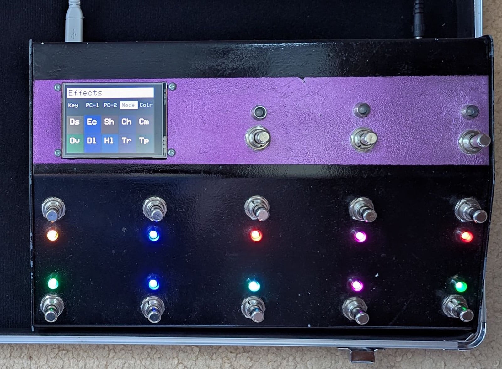

> ⚠️ **Build at your own risk.** MIDI Toolbox is provided "as is", with no warranty of any kind (see the [licence](../LICENSE)). Building a unit involves drilling, cutting, soldering and mains-powered tools. The wiring and drawings here and in the Designer have not been reviewed by a qualified engineer. **Verify your wiring** against your parts' datasheets and check it with a multimeter before you apply power, and **measure your own parts** before you drill or cut anything: holes cannot be un-drilled.

## First, a disclaimer

This was my first serious electronics project. I had a _lot_ of help; especially from my friend Sam (who supplied many of the parts), and the Teensy forum members. There are many things that could be improved! The wiring, for example, is not something I am proud of. If you are an experienced maker then you will undoubtedly get a better end result than me :)

## What it is

- 13 footswitches in rows of 5, 5 and 3 (the top row of three are the **navigation** switches - see below).
- One RGB LED beside every footswitch, showing that button's colour and state.
- A 2.8" ILI9341 touchscreen (320 x 240, landscape) that shows the current Mode/Bank/Patch and a grid mirroring the performance buttons.
- A Teensy 4.1 that appears to the computer as a USB-MIDI device and reads configs from its built-in SD card slot.

Button ids in config files run 0-12:

```
    [TFT]  10  11  12        <- navigation: Select, Step down, Step up

    5   6   7   8   9

    0   1   2   3   4
```

## How I built it

I started with a Teensy. I was skeptical about how small it was going to be, but it was in deed teensy:

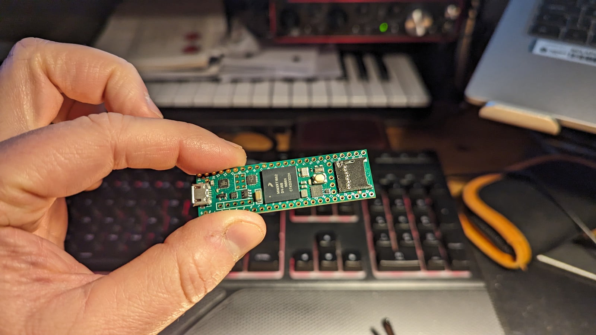

I did experiments on a breadboard to verify I could send MIDI messages using a Teensy with some C++ firmware I wrote:

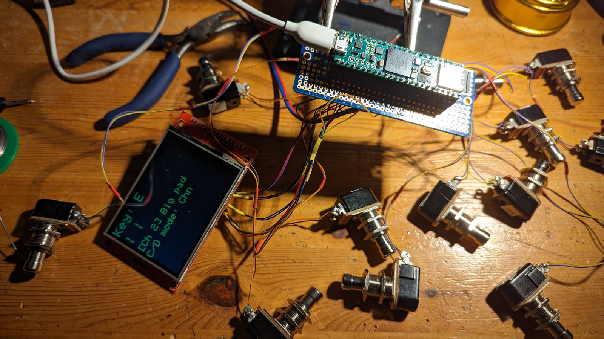

As I wanted RGB LEDs and there are not enough pins on the Teensy to do this, I used shift registers. Again, those needed some breadboard work:

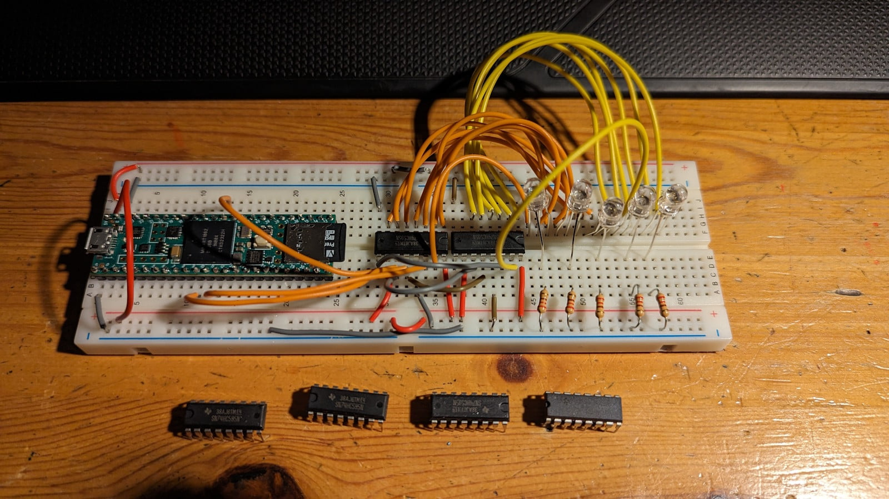

I found out that the 5V power from the Teensy could not light up all 13 LEDs:

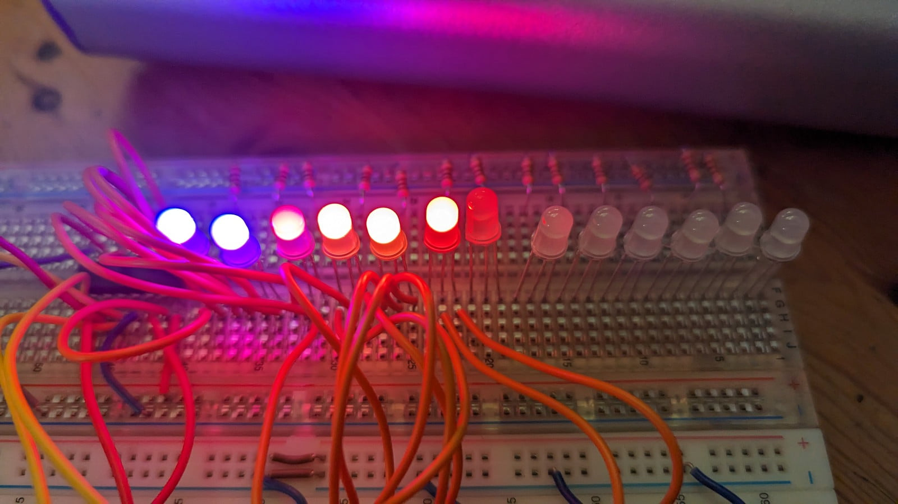

So I added a regulator for an external 9V power supply. The Teensy would continue to be powered by USB.

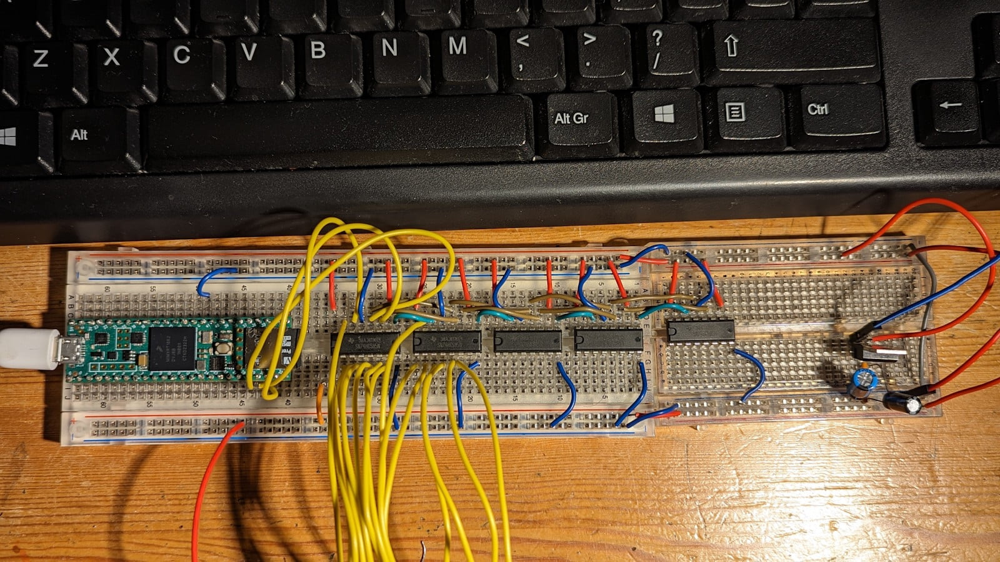

At this point I built everything into a plastic toolbox, the kind used to hod screws. This, of course, is the source of the name of the project "MIDI Toolbox":

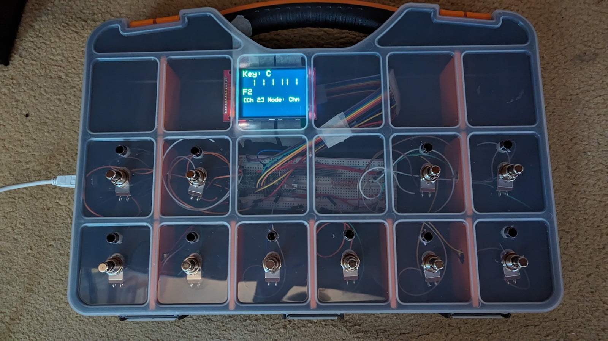

This prototype helped me a lot when it came to choosing an enclosure and deciding where to drill holes:

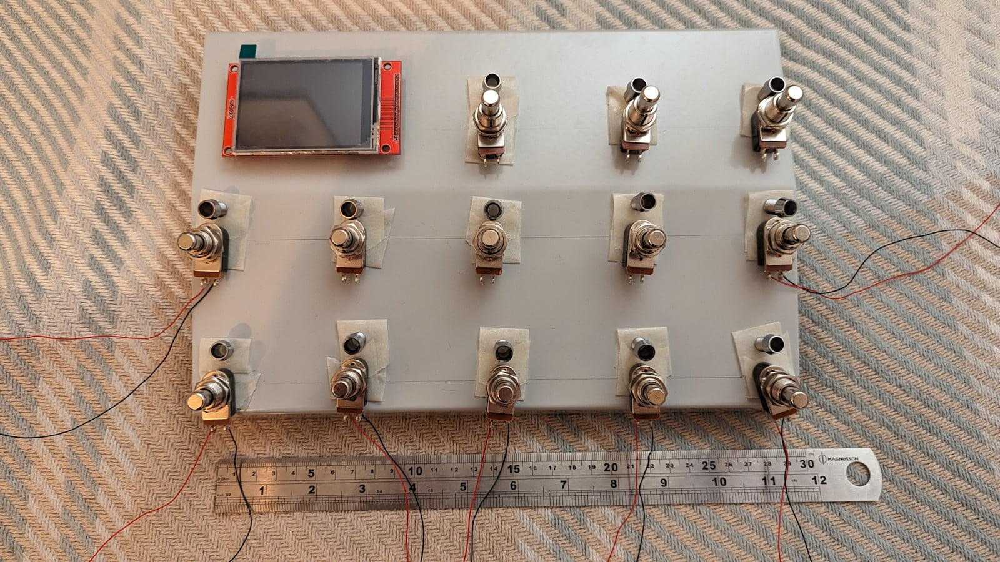

I build the main components on small boards that I could screw into the case (onto plastic spacers):

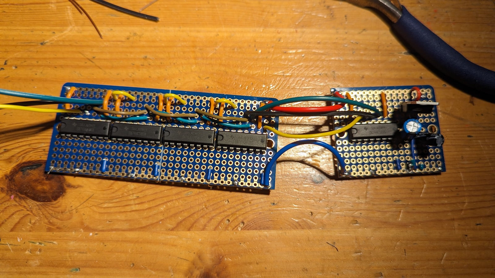

But because there were a lot of wires involved (yes, there are several ways I could make this better, I know that now) building the internals was fiddly:

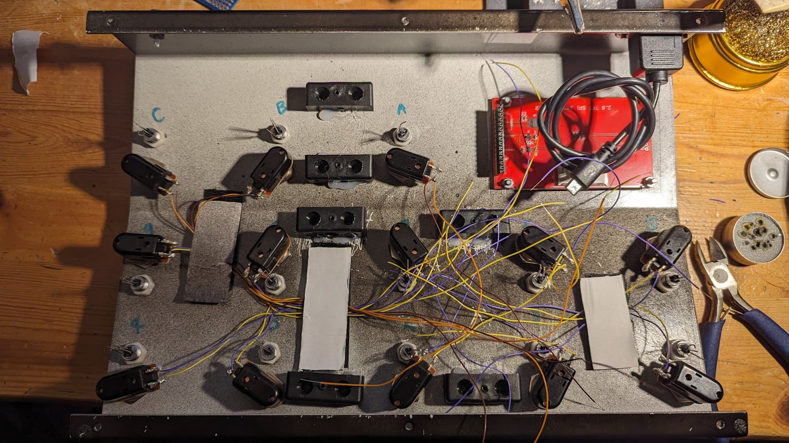

And got worse (here you see sticky-back velcro, used to try to tame some of the wires):

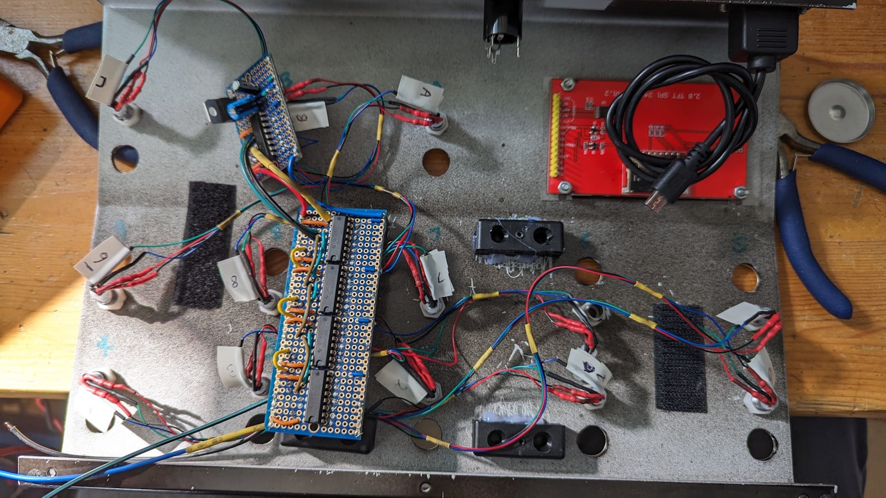

Finally I had something that worked:

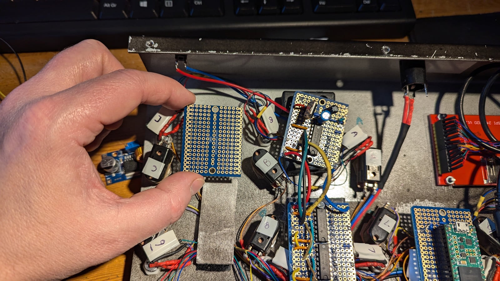

I painted the enclosure (described by a friend as "a shockingly bad paint job"):

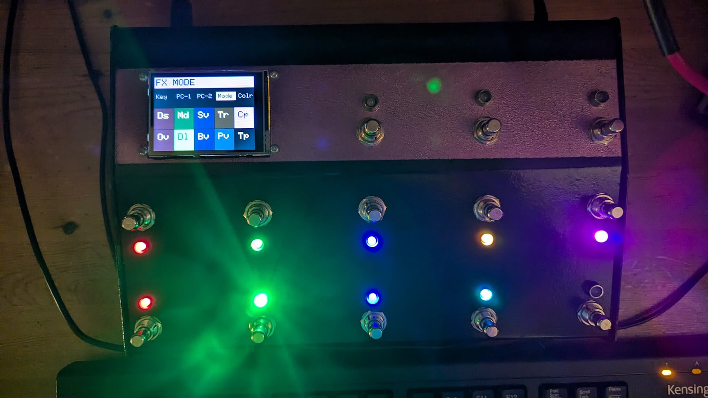

And it's been part of my live rig ever since:

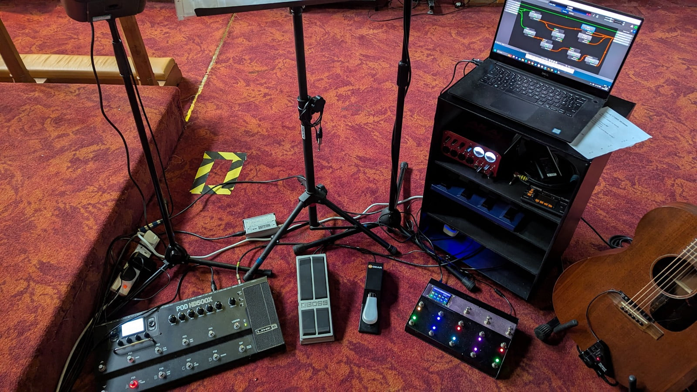

## Parts

| Qty | Part | Notes |
| ---: | --- | --- |
| 1 | [Teensy 4.1](https://www.pjrc.com/store/teensy41.html) | the brains; built-in SD slot |
| 1 | 2.8" ILI9341 SPI TFT with XPT2046 touch | [example](https://www.pjrc.com/store/display_ili9341_touch.html) |
| 13 | Soft-touch momentary footswitches (SPST, normally open) | the clicking kind are loud |
| 13 | 5 mm RGB LED, **common anode** | red 1.8-2.0 V, green/blue 3.2-3.4 V, 20 mA max per colour |
| 5 | 74HC595 shift register (DIP-16) | 40 outputs for 39 LED channels |
| 13 | Resistor, 220 ohm | one per LED; size to your LEDs' forward voltage and the current you want (I should probably have used on resister per LED colour leg) |
| 1 | Resistor, ~100 ohm | screen backlight |
| 5 | 100 nF ceramic capacitor | decoupling, one per shift register |
| 1 | microSD card | holds your configs |
| 1 | micro-USB cable | power and MIDI |
| - | Hook-up wire, headers, solder | |
| 1 | Hammond 515-0950 enclosure | You can choose a different enclosure and design the layout with the  Designer app |

The Designer's [parts list](designer-guide.md#6-export) for the "Current MIDI Toolbox (13 buttons, foot)" example is generated by the same rules as this table and is a good cross-check.

## Wiring

> ⚠️ **Verify before you power up.** The diagram and tables below are the author's own build, not a certified design. Check each connection against the datasheets of the parts you bought, especially LED polarity (common anode), the regulator and the 5 V rail. With nothing plugged in, use a multimeter to check for shorts between 5 V, 3.3 V and ground, then power up one stage at a time (see [Test as you go](#test-as-you-go)). A mistake can damage the Teensy, the screen or your computer's USB port. You build at your own risk.

The reference diagram is [`graphics/Midi-Toolbox.drawio`](../graphics/Midi-Toolbox.drawio) (open with [draw.io](https://app.diagrams.net)). The authoritative pin numbers are in [`MIDI-Toolbox/MidiToolboxDevice.h`](../MIDI-Toolbox/MidiToolboxDevice.h).

### Footswitches

Each footswitch connects one Teensy pin to ground. The firmware enables the Teensy's internal pull-up on each pin, so **no external resistor is needed**. Button id to Teensy pin:

| id | 0 | 1 | 2 | 3 | 4 | 5 | 6 | 7 | 8 | 9 | 10 | 11 | 12 |
| --- | --- | --- | --- | --- | --- | --- | --- | --- | --- | --- | --- | --- | --- |
| pin | 33 | 34 | 35 | 36 | 37 | 38 | 39 | 40 | 41 | 15 | 21 | 22 | 23 |

### Screen (SPI)

| Screen | Teensy pin |
| --- | --- |
| SCK | 13 |
| MOSI | 11 |
| MISO | 12 |
| CS | 10 |
| DC | 9 |
| RESET | 6 |
| T_CS (touch) | 8 |
| T_IRQ (touch) | 2 |

Power the screen from 3.3 V (or per your module's instructions) and put a resistor in series with the backlight pin.

### LEDs (74HC595 chain)

The 13 RGB LEDs use 39 channels, driven by a chain of five 74HC595 shift registers. The chain is bit-banged, but the firmware fixes these three pins (the ShiftPWM library needs them at compile time), so use exactly these:

| 74HC595 | Teensy pin |
| --- | --- |
| LATCH (ST_CP) | 28 |
| DATA (DS) | 29 |
| CLOCK (SH_CP) | 30 |

Chain the registers by connecting each one's serial out (Q7S) to the next one's DATA (DS), and share LATCH and CLOCK across all five. Power each from 5 V with a 100 nF capacitor close by.

The LEDs are **common anode**: the long leg goes to positive, and each colour's leg goes through its own resistor to a shift-register output, which *sinks* the current. The firmware sets `ShiftPWM_invertOutputs = true` for this. If your LEDs are common cathode, change that and the wiring together.

**LED power.** The Teensy's 5 V pin cannot supply every LED, so the LEDs and the 74HC595s run from a separate 9 V DC supply stepped down to 5 V by a regulator (a 7805 or a 5 V buck module), with a 100 µF capacitor across the 5 V rail. Join all the grounds (supply, regulator, Teensy). Do not connect the 5 V LED rail to the Teensy's 5 V/VIN pin while USB is plugged in. The Teensy itself is still powered over USB.

### Test as you go

Check the wiring with a multimeter before you apply power for the first time, then build and test in stages: the Teensy alone, then footswitches, then the screen, then LEDs. With the Arduino serial monitor open (115200 baud) the firmware logs `Button N pressed` for each footswitch.

## Enclosure

> ⚠️ **Measure twice, drill once.** Drilling and cutting cannot be undone, and the drawing is only as right as the parts you measured. Measure your own footswitches and screen before you mark anything, and wear eye protection when drilling or cutting metal. You build at your own risk.

The prototype lived in a plastic compartment organiser box whose compartments happened to match the button spacing. The face of the final unit (a Hammond 515-0950 enclosure) is 297 × 196 mm; [`graphics/drawing.svg`](../graphics/drawing.svg) is the drilling template.

> **Measure your parts before you drill.** Footswitch and screen dimensions vary between makers. Check each against the drawing and test-fit on scrap material first - drilling cannot be undone.

For foot control the Designer asks for buttons at least 50 mm apart centre-to-centre. (The first all-in-a-grid 13-button paper mock-up was too cramped for big feet, which is why the final layout keeps the three navigation switches in their own row.)

## Firmware

The easy way is [the desktop app](desktop-app-guide.md): plug the Teensy in, open the **Device** screen, **Connect** and choose **Install bundled firmware**, then **Upload device.json...** (use [`config/live-rig-device.json`](../config/live-rig-device.json) for this 13-button unit) and **Restart the unit**. No Arduino IDE needed.

To build the firmware yourself instead:

1. Install the [Arduino IDE](https://www.arduino.cc/en/software) and [Teensyduino](https://www.pjrc.com/teensy/td_download.html).
2. Install the libraries the firmware uses (the versions it is built and tested with are in brackets):
   - **ArduinoJson** (7.4.3) and **LVGL** (9.6.0), from the Arduino Library Manager;
   - [**ILI9341_T4**](https://github.com/vindar/ILI9341_T4) (1.7.1), from GitHub (Sketch > Include Library > Add .ZIP Library);
   - **Bounce**, **ShiftPWM**, SD, SPI and EEPROM come with Teensyduino (core `teensy:avr` 1.62.0).
   - **LVGL needs the project's configuration.** Copy [`MIDI-Toolbox/lvgl/lv_conf.h`](../MIDI-Toolbox/lvgl/lv_conf.h) into your Arduino `libraries` folder, next to (not inside) the `lvgl` folder. It is LVGL's standard template with a few widgets switched off and the fonts the screen uses switched on; without it the sketch runs out of RAM1 or lacks a font.
3. Open `MIDI-Toolbox/MIDI-Toolbox.ino`. The unit's wiring is read from `/device.json` on the SD card at start-up (see above), so copy that file there too. `MidiToolboxDevice.h` next to the sketch is the compile-time equivalent, already set for this 13-button unit.
4. Choose **Tools > Board > Teensy 4.1** and **Tools > USB Type > Serial + MIDI**.
5. Upload.

### Getting configs onto the SD card

Config files are `.json` files in the `/configs` folder on the SD card; the unit remembers which one was last selected. You can:

- use the [desktop app](desktop-app-guide.md)'s **Device** screen to upload them over USB (the simplest way);
- put the SD card in your computer and copy the file across, or
- flash the small [`MTP/`](../MTP/) sketch, which makes the Teensy appear as a drive over USB; copy files to the SD card, then re-flash the main firmware.

[`MIDI-Toolbox/configs/Live Rig.json`](../MIDI-Toolbox/configs/Live%20Rig.json) is a ready-made starting point. Make your own with the [Editor](editor-guide.md).

## Using it

Plug the unit into your computer. It appears as a USB-MIDI device; select it as the MIDI input in your DAW, synth or sample player. The three navigation switches (and matching on-screen buttons) move between Config, Mode, Bank and Patch - see [navigation design](navigation.md). Moving through options never interrupts sound already playing; changes take effect only when you confirm with **Set?**.
